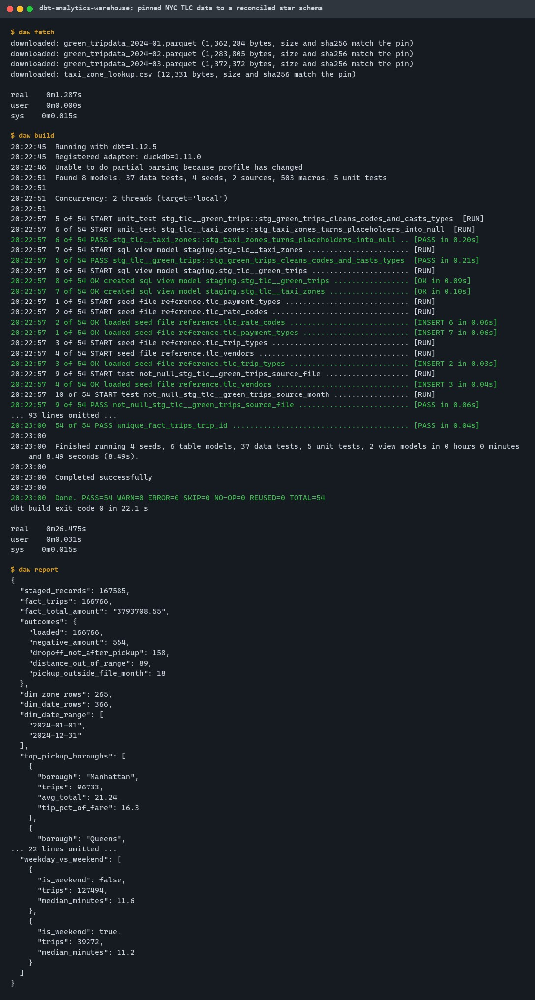
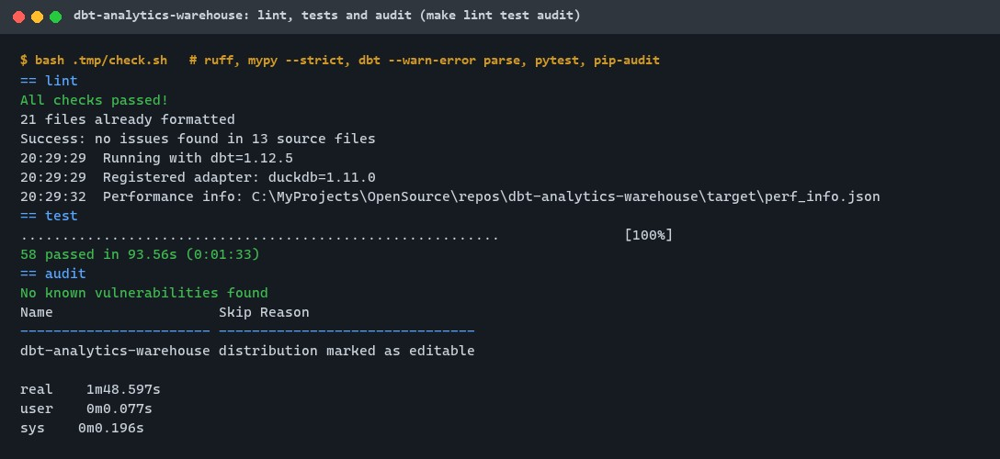
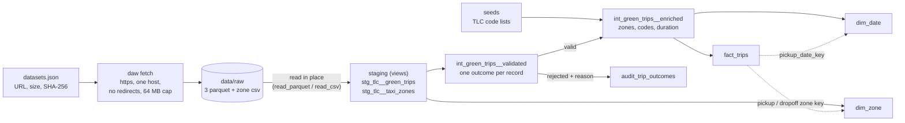
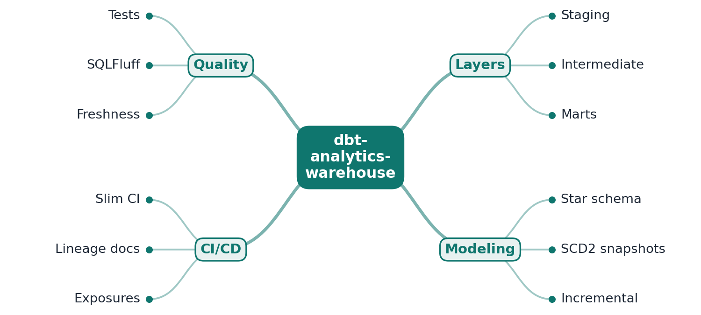
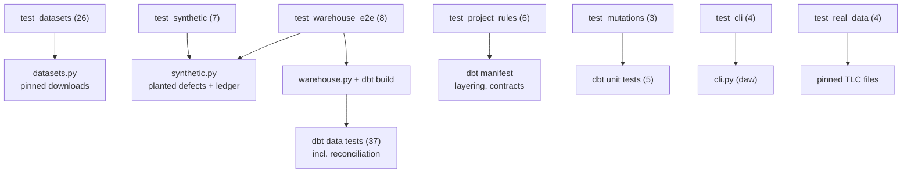

# dbt-analytics-warehouse

[](https://github.com/EquinoxWN/dbt-analytics-warehouse/actions/workflows/ci.yml)


> The difference between 'some SQL' and a warehouse a team can trust: tested, documented, version-controlled models on public data.

Part of my **Data Engineering** list · SQL · Python

## Proof it works

Three months of NYC green taxi records (167,585, pinned by SHA-256) go through staging,
intermediate and mart models into a star schema. Every record is accounted for: 166,766 reach
`fact_trips` and 819 (0.49%) are rejected with a named reason, and the money reconciles to the
cent. `dbt build` runs 54 nodes (4 seeds, 8 models, 37 data tests, 5 unit tests), all passing:



58 Python tests pass, including end-to-end builds on synthetic files with planted defects and
mutation tests that break a rule and expect a unit test to fail. Lint, `mypy --strict`, dbt parse
with warnings as errors, and the dependency audit are clean:



## Architecture

**What M1 runs today:**



**Full roadmap (M1 to M3):**



## How it works

_Steps 1 and 2 are built and tested (M1); the rest is on the [roadmap](#roadmap)._

1. Raw trip data lands in staging models that only rename, cast and clean.
2. Intermediate models join and enrich; marts expose a star schema (fact_trips, dim_zone, dim_date) for BI tools.
3. Snapshots track slowly changing dimensions (SCD Type 2), and large facts build incrementally.
4. Every model has tests (unique, not null, relationships, accepted ranges), and SQLFluff enforces SQL style.
5. Slim CI builds only modified models and their children against production state, keeping PR checks fast.
6. dbt docs generates a lineage site you run locally, and exposures link marts to the dashboards that use them.

In M1, staging never drops a row. `int_green_trips__validated` gives every record exactly one
outcome: kept, or the first of eight rules it breaks (duplicate, missing timestamp, dropoff not
after pickup, duration over 24 h, pickup outside the file's month, negative amount, distance
outside 0 to 200 miles, unknown zone). `fact_trips` holds the kept trips; `audit_trip_outcomes`
counts records and money per file and outcome, and a dbt test fails the build if they do not add
up ([ADR 0002](docs/adr/0002-reject-with-a-reason-and-account-for-every-record.md)).

## Who it helps

- **Analytics engineers** starting a dbt project get a working layout to copy: sources read in
  place, staging that only renames and casts, intermediate rules, contracted marts, and pytest
  checks that enforce the layering from dbt's manifest.
- **Analysts and BI developers** get a star schema whose numbers they can defend: no dashboard
  filter to remember, and `audit_trip_outcomes` says exactly which records were left out and why
  (on the pinned data, 89 odometer faults would otherwise raise the average trip from 2.64 to
  20.91 miles).
- **Reviewers and learners** can build the whole warehouse on a laptop with no server or Docker
  (`make setup data build report`; fetch and build took under 30 s here), and see how dbt unit tests, data tests and
  contracts each catch a different kind of mistake.

## Tech stack

| Area | In M1 | Planned |
|---|---|---|
| Core | dbt Core 1.12, DuckDB 1.5 (dbt-duckdb), NYC TLC green trip files | Postgres target |
| Modeling | staging, intermediate, star schema marts with enforced contracts, audit mart | SCD Type 2 snapshots, incremental facts |
| Quality | dbt data tests and unit tests, pytest (end-to-end, layering rules, mutations), ruff, mypy `--strict` | dbt-expectations range tests, SQLFluff |
| CI | lint, tests, real-data build with a `::notice` result, pip-audit | slim CI with `state:modified+`, docs site, exposures |

Language: **SQL · Python** (3.11+). dbt project at the repository root (`models/`, `seeds/`,
`macros/`, `data_tests/`); the Python package in
[`src/dbt_analytics_warehouse/`](src/dbt_analytics_warehouse) holds the pinned-download code,
the synthetic data generator, the dbt runner and the `daw` command.

## Run it

**Prerequisites:** Python 3.11+. No database server or Docker; the input data is about 4 MB. Everything
the build writes stays in git-ignored folders in the repository (`.venv/`, `data/`, `target/`,
`logs/`, `.tmp/`); dbt reads `profiles.yml` from the repository, never from `~/.dbt`.

```bash
python -m venv .venv && source .venv/bin/activate   # Windows: .venv\Scripts\activate
make setup     # install exact versions from constraints.txt
make lint      # ruff, ruff format, mypy --strict, dbt parse --warn-error
make data      # download the 4 pinned files (about 4 MB), size and SHA-256 checked
make build     # dbt build into data/warehouse.duckdb
make report    # reconciliation, star schema sizes, two sample BI answers (JSON)
make test      # 58 tests (4 of them need `make data`)
make clean-data   # delete the warehouse and the downloaded files
```

Query the star schema with any DuckDB client, for example:

```sql
select z.borough, d.day_name, count(*) as trips, avg(f.total_amount) as avg_total
from marts.fact_trips f
join marts.dim_zone z on f.pickup_zone_key = z.zone_key
join marts.dim_date d on f.pickup_date_key = d.date_key
group by all order by trips desc;
```

`daw synth --out .tmp/synth` writes synthetic TLC-shaped files with planted defects, and
`daw build --raw-dir .tmp/synth --db .tmp/synth.duckdb` builds a separate warehouse from them.

## Tests and results

Full numbers, method and analysis: [docs/results/m1.md](docs/results/m1.md).

| Check | Result |
|---|---|
| Tests (`make test`) | **58 passed**, 0 failed (with the pinned data downloaded) |
| dbt build on real data | **54 of 54** nodes pass: 4 seeds, 8 models, 37 data tests, 5 unit tests |
| Every record accounted for | 167,585 raw = 166,766 in `fact_trips` + 819 rejected, per file; money difference $0.00 |
| Rejections by reason | negative amount 554, dropoff not after pickup 158, distance out of range 89, pickup outside the file month 18 |
| Star schema | `dim_zone` 265 rows, `dim_date` 366 rows; 0 orphan keys, 0 duplicate `trip_id` |
| Build time | dbt 3.8 s and 8.5 s in two runs; 11.9 s and 22.1 s wall time with dbt start-up (shared laptop) |
| Lint / audit | ruff, ruff format, mypy `--strict`, `dbt --warn-error parse`: clean; pip-audit: no known vulnerabilities |

| Test file | Tests | What it proves |
|---|---|---|
| `tests/test_datasets.py` | 26 | Manifest validation (15 unsafe entries rejected), downloads kept only on matching size and SHA-256, nothing left behind on failure, redirects refused |
| `tests/test_synthetic.py` | 7 | The generator is deterministic, uses the exact TLC schema, and its ledger matches the files |
| `tests/test_warehouse_e2e.py` | 8 | `dbt build` on synthetic data: every record gets its planted outcome, money and keys reconcile, dimensions are right; two more random seeds reconcile |
| `tests/test_project_rules.py` | 6 | From dbt's manifest: layer prefixes, only staging reads sources, no backward references, materializations and contracts, documentation, foreign-key tests |
| `tests/test_mutations.py` | 3 | Three planted SQL bugs in a project copy each fail the matching dbt unit test |
| `tests/test_cli.py` | 4 | `daw` output and clear exit-code-2 errors, including an unsafe raw path refused before dbt runs |
| `tests/test_real_data.py` | 4 | On the pinned files: checksums, real schema equals synthetic schema, per-file reconciliation counted outside dbt, dimension sizes |
| dbt unit tests (model YAML) | 5 | Staging cleaning and casting, zone placeholders, the eight rules and their order, enrichment, the date dimension |

### Test map



## Roadmap

**M1** (≈8 h)
- [x] Write `docs/rfc/0001-design.md`: problem, goals, non-goals, chosen design
- [x] Raw trip data lands in staging models that only rename, cast and clean.
- [x] Intermediate models join and enrich; marts expose a star schema (fact_trips, dim_zone, dim_date) for BI tools.

**M2** (≈8 h)
- [ ] Snapshots track slowly changing dimensions (SCD Type 2), and large facts build incrementally.
- [ ] Every model has tests (unique, not null, relationships, accepted ranges), and SQLFluff enforces SQL style.

**M3** (≈9 h)
- [ ] Slim CI builds only modified models and their children against production state, keeping PR checks fast.
- [ ] dbt docs generates a lineage site you run locally, and exposures link marts to the dashboards that use them.
- [ ] Publish the proof below with real numbers

## Proof

What this repo must show before it counts as done:

- CI duration before and after slim CI, lineage-graph screenshots, and one sample dashboard.

| Result | Value |
|---|---|
| M3 proof above | Not measured yet (M3). Current M1 numbers: see [Tests and results](#tests-and-results). |

## Why it matters

- **Interview angle:** 'Model a warehouse for analytics': star schemas and SCDs.
- **Upstream I'm contributing to:** dbt-core adapters or SQLFluff.

## Design docs

- [RFC 0001: design](docs/rfc/0001-design.md)
- [ADR 0001: record architecture decisions](docs/adr/0001-record-architecture-decisions.md)
- [ADR 0002: reject records with one named reason, and account for every record](docs/adr/0002-reject-with-a-reason-and-account-for-every-record.md)
- [ADR 0003: DuckDB reads pinned public files in place](docs/adr/0003-duckdb-reads-pinned-files-in-place.md)
- [M1 results](docs/results/m1.md)

## Scope

This is a learning and portfolio system, not a hosted production service. Everything runs locally.

## Security and contributing

- Every GitHub Action is pinned to a commit SHA; workflows run read-only, without persisted credentials.
- Dependabot update pull requests are paused (`open-pull-requests-limit: 0`) so the repository keeps a single `main` branch; dependencies are updated by hand and checked by the CI audit.
- Dependency versions are pinned in `constraints.txt`; downloads go only to the TLC HTTPS host, without redirects, capped in size and kept only when size and SHA-256 match; paths placed in SQL are checked; CI runs `pip-audit` on every push.
- Report vulnerabilities privately: see [SECURITY.md](SECURITY.md). To contribute, see [CONTRIBUTING.md](CONTRIBUTING.md).

## License

MIT, see [LICENSE](LICENSE).
